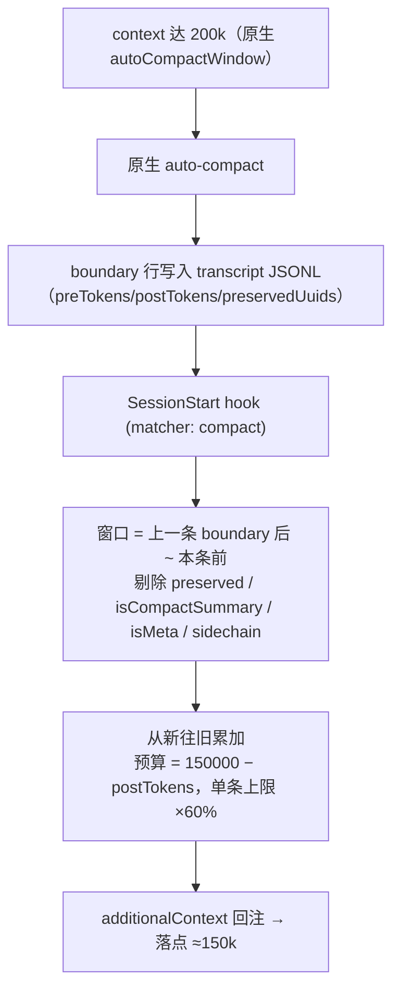

# context-keeper

Claude Code 插件：context 到 **200k** 自动压缩后，**忠实回注近期原文**，使落点稳定在 **≈150k**——只摘要最老的部分，近期细节（文件内容、SQL 输出、对话决策）不丢。

主 spec：`docs/features/context-keeper/specs/context-keeper.md`（v1.0）

## 机制



回注触发策略：`auto` 压缩 → 回注；手动 `/compact` 裸敲 → 回注；`/compact 带指令` → **不回注**（尊重显式意图，经 PreCompact 侧标检测）。

## 前置配置（缺一不可）

`~/.claude/settings.json`：

```json
{
  "autoCompactEnabled": true,
  "autoCompactWindow": 200000
}
```

- `autoCompactWindow: 200000` 是**发条**：1M 窗口模型默认 ~967k 才压缩，不配它插件永远等不到触发（插件无权发起压缩）。
- `autoCompactEnabled: true` 本为默认值，显式写上防呆。
- 这两个配置只解决"何时压"；"压完剩多少"由本插件补齐（原生落点不可配，实测 478k→19.6k）。

## 安装

本地路径直装（当前形态）：

```bash
claude plugin marketplace add D:\program\context-keeper
claude plugin enable context-keeper@context-keeper
```

推送到 GitHub 后可一行安装（`<owner>/<repo>` 替换为实际仓库）：

```
/plugin install context-keeper --marketplace <owner>/<repo>
```

零 npm 依赖，Node ≥18。卸载即恢复原生行为。

## 兜底

钩子任何异常 → exit 0 空输出 = **没装插件**，原生压缩照常。对会话只读（唯一副作用：`%TEMP%/context-keeper/` 下的侧标与 `last-run-*.json` 日志）。

## 验收清单（手动 E2E，需真会话）

1. 临时会话持续读大文件，灌到 context >200k。
2. 观察原生 auto-compact 触发（spike #0）。
3. 查 `%TEMP%/context-keeper/last-run-<session>.json` 存在且 `outcome` 字段有值。
4. `/context` 读数落在 **145k–160k**。
5. 回归：停用插件再压一次，原生行为不受损（兜底层活着）。

## Spike 判定表（运行时实证，结果回填 spec §11）

| # | 操作 | 期望 | 若证伪 → Plan B |
|---|---|---|---|
| 0 | E2E 步骤 2-3：auto 压缩后查 last-run 日志 | 日志生成（SessionStart(compact) 在 auto 路径触发） | **停用插件**，改用 UserPromptSubmit 检测新 boundary 方案 |
| 1 | E2E 步骤 4：`/context` 落点 | 145k–160k | 落点 <145k **且日志见截断** → 排查 additionalContext 尺寸上限或降 `CK_TARGET_TOTAL`；落点 <145k **但日志无截断**（注入不足：估算按原文 JSON、渲染有 300 字符帽，偏保守）→ **升** `CK_TARGET_TOTAL`（如 170000），代码级校准留 v1.1（按渲染文本分摊预算） |
| 2 | 第二次压到 200k，对比新 boundary 的 preTokens | preTokens 已计入上轮回注内容 | 未计入 → 150k 数学失效，**停用上报** |
| 3 | 日志观察：compact 触发时 boundary 是否可读 | 正常注入 | 读不到 → 空转（原生行为），排查落盘时序 |
| 4 | 日志观察：回注块是否回写 JSONL、以何形态 | 记录形态即可 | 规则 5.4 已剔除摘要类条目，无阻塞风险 |
