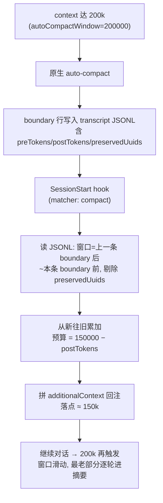
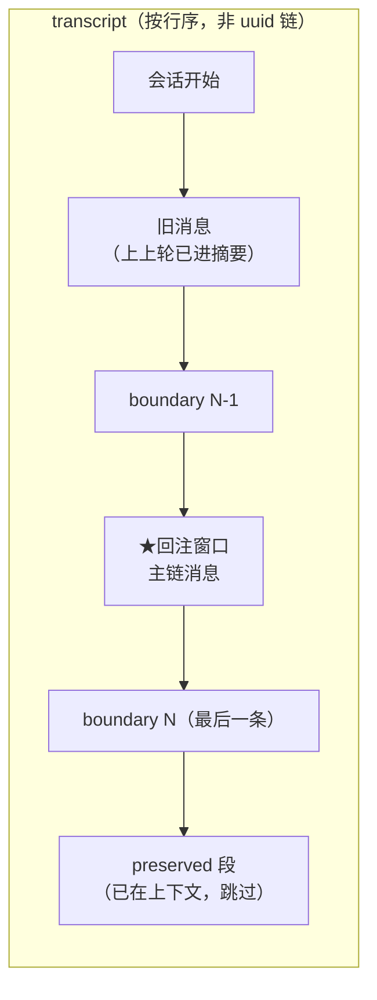
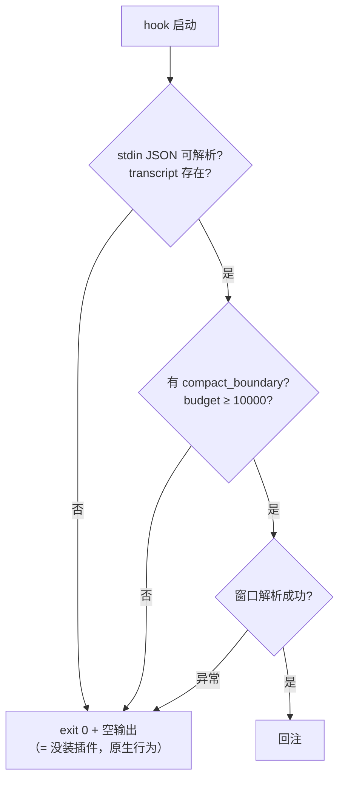

# context-keeper · 主 spec

> **状态**: **v1.0 定稿**（2026-10-28，Q3/Q4 已拍板；下一步 plan）
> **一句话**: context >200k 自动压缩后，忠实回注近期原文，使落点稳定在 ≈150k
> **变更历史**: 见 `specs/archive/context-keeper-changelog.md`（本文件只反映当前真相）

---

## 1. 意图

**背景**：本机 Claude Code 走 1M 窗口模型（glm-5.3-flash[1M]）。原生 auto-compact 默认 ~967k 才触发；用 `autoCompactWindow: 200000` 可把触发钉到 200k，但**压缩落点由 harness 决定、不可配置**（实测一例：478286 → 19582 tokens，细节丢失 95%+）。

**方案**：触发交给原生配置；插件用 `SessionStart`（matcher `compact`）钩子在压缩完成后，把"想保留的近期原文"从 transcript JSONL 读出、以 `additionalContext` 回注，落点 ≈150k。

| 类别 | 内容 |
|---|---|
| **Goals** | ① 落点 ≈150k（±10%）② 全自动无感 ③ 对会话只读（唯一写操作=hook stdout）④ 任何异常静默降级为原生行为 |
| **Non-goals** | ① 主动发起压缩（平台无此能力，钩子只能观察/阻断）② 结构化摘要方案 A'（已否决，选 A 忠实原文）③ 修改内置压缩本身 |
| **Anti-goals（出现即缺陷）** | ① hook 报错拖累会话启动 ② 回注内容与 harness preserved 段重复 ③ "原来能压 → 装了反而压不了" |

---

## 2. 前置依赖（原生配置，非插件代码）

```json
// settings.json
{
  "autoCompactEnabled": true,
  "autoCompactWindow": 200000
}
```

这两个配置**只完成触发**；落点 150k 由本插件补齐。安装说明必须包含此配置（插件自身无法代写用户 settings）。

---

## 3. 总体机制



---

## 4. 数据源：transcript JSONL（实测结构，v2.1.311）

会话文件：`~/.claude/projects/<project-slug>/<session-uuid>.jsonl`。**compact 后压缩前消息完整保留**（实测 12256 行文件含 3 个 boundary，历史不删）。

`compact_boundary` 记录实测字段（来源：真实会话 7562e3c6，2026-10-27 取证）：

```json
{
  "type": "system", "subtype": "compact_boundary",
  "compactMetadata": {
    "trigger": "manual",                  // manual | auto
    "preTokens": 478286,                  // 压缩前精确 token 数（harness 计算）
    "postTokens": 19582,                  // 压缩后精确落点
    "preservedSegment": {"headUuid", "anchorUuid", "tailUuid"},
    "preservedMessages": {"anchorUuid", "uuids", "allUuids"}   // 已在活上下文里的消息
  }
}
```

boundary 后紧跟 `isCompactSummary: true` 的 user 行 = 摘要正文。

---

## 5. 窗口选择与去重规则



规则（全部为已裁决项）：

1. **窗口 = 上一条 boundary 之后 ~ 最后一条 boundary 之前**；只看最后一条 boundary，永不越界（上轮回注块属于"最老部分"，本轮进摘要正是需求本意）。
2. **只取主链**：`isSidechain !== true`（子 agent 消息不回注）。
3. **剔除** `preservedMessages.uuids` 集合内的消息（防与活上下文重复）。
4. **剔除** `isCompactSummary === true` 条目。
5. **按行序**选取，不依赖 uuid 链（压缩后 parentUuid 链有断点，行序稳健）。
6. **剔除** `isMeta === true` 条目（系统提醒/命令回显等包装行，非用户发言）。
7. **回注触发策略（Q3 已拍板）**：`auto` → 回注；`manual` 裸敲 → 回注；`manual` 且带自定义指令 → **不回注**（尊重显式意图）。检测机制：PreCompact 钩子（输入含 `custom_instructions`）写临时侧标文件（session 级），SessionStart 读后即删；侧标缺失时 manual 一律不回注（保守兜底）。
8. 从新往旧累加，达到预算即停。
9. **新鲜度守卫（v0.1.1，2026-11-02 实战竞态修复）**：hook 启动时刻与最后一条 boundary 的 timestamp 差 > `STALE_MS`（默认 120s）= 疑似读到落盘前旧态（10-30 实战发生 1/105）→ 以 1s 间隔重读至多 5 次；重读出新鲜 boundary 则用它，重试穷尽仍陈旧 → 不回注（outcome=`skipped-stale`，保守）。timestamp 不可解析 → 视为新鲜（不破坏既有行为）。

---

## 6. 预算与 token 估算

```
TARGET_TOTAL = 150000          // 常量；env CK_TARGET_TOTAL 可覆盖
budget       = TARGET_TOTAL − postTokens
budget < 10000 → 不回注（nothing worth injecting）

est(msg_i) = chars_i / Σchars(窗口) × (preTokens − postTokens)   // 自校准：总量精确、按字符分摊
单条上限     = budget × 60%   // Q4 已拍板：超限截尾，标注"〔截断，原文共 X tokens〕"，防止巨型 tool_result 独吞预算
```

**数值代入预演**（用实测数字）：preTokens=478286、postTokens=19582 → budget = **130418**；从 boundary 前最新消息往旧累加至 130418；落点 = 19582 + 130418 ≈ **150k** ✓

---

## 7. 回注内容渲染

| 块类型 | 处理 |
|---|---|
| user 文本 | 全文 |
| assistant 文本 | 全文 |
| assistant tool_use | 工具名 + input 前 300 字符 |
| tool_result | 全文（细节价值主要在此）；单条超预算×60% 时截尾 + 标注"〔截断，原文共 X tokens〕" |
| thinking | 跳过 |
| isMeta 行 | 跳过（§5.6） |

每条前缀 `[user] / [assistant] / [tool_use 名] / [tool_result]`；块顶 banner 注明"以下为 context-keeper 回注的近期对话原文（已被压缩摘除，回注保留细节）"。

输出（SessionStart 钩子协议）：

```json
{"hookSpecificOutput": {"hookEventName": "SessionStart", "additionalContext": "<500KB 级字符串>"}}
```

---

## 8. 兜底链（铁律：不破坏既有行为）



- 全代码包 try/catch；**禁止 exit 2**（不阻断会话启动）；最坏情况 = 插件不存在。
- 流式 readline 解析（100MB+ 文件不可整载）；目标耗时 <5s。
- 插件**只读 transcript + 写 stdout**；唯一持久化 = PreCompact 钩子的临时侧标文件（session 级，SessionStart 读后即删，用于 Q3 的 manual 指令检测），除此之外无状态、天然幂等。

---

## 9. 仓库与插件结构

```
D:\program\context-keeper\
├── .claude-plugin\plugin.json      # name: context-keeper
├── hooks\
│   ├── hooks.json                  # SessionStart/compact → node reinject.js
│   └── reinject.js                 # 核心逻辑（零依赖，node >= 18）
├── test\
│   ├── fixtures\                   # 仿真实 schema 的 mini JSONL
│   └── reinject.test.js
├── docs\features\context-keeper\specs\   # 本 spec
└── README.md                       # 安装: marketplace 路径 + settings 两配置
```

hooks.json 要点：`command: node "${CLAUDE_PLUGIN_ROOT}/hooks/reinject.js"`，matcher `compact`。

---

## 10. 验收判据（数值代入过）

| 层 | 判据 |
|---|---|
| fixtures 单测 | 构造双 boundary mini JSONL：断言窗口选取、preserved 剔除、budget 边界（代入实测数字：postTokens=19582 → budget=130418） |
| 真实 JSONL 冒烟 | 对 7562e3c6 全量跑 hook：additionalContext 估算 token 落在 130418 ±10%，耗时 <5s |
| E2E | 真会话触发一次 compact：`/context` 实测落点 145k–160k；**回归**：停用插件后再 compact，原生行为不受损（兜底层活着） |

---

## 11. Spike 清单（plan 阶段执行，探针先行）

| # | 待实证 | 现有证据 | 若证伪的 Plan B |
|---|---|---|---|
| 0 | **auto 压缩是否发 `SessionStart(source=compact)`** | 官方文档把 matcher `compact` 记为"压缩后重注"的标准路径且无 manual 限定；二进制 source 枚举含 `compact`；实测样本均来自 manual 压缩（builder 审查指出） | 改 `UserPromptSubmit` 钩子检测新 boundary 触发回注 |
| 1 | `additionalContext` 尺寸上限（~500KB 字符串） | 无 | 实测；被截断则降 budget |
| 2 | 注入内容是否计入下一轮 preTokens | `additionalContext` 的定义即"进入上下文" | 若不计入→150k 数学失效，需改载体 |
| 3 | SessionStart 触发时 boundary 行是否已落盘 | 历史会话文件中 boundary 均已持久化；**2026-10-30 实战命中 1 次/105**（880bfe60：hook 读到上一条 boundary 旧态 → 错窗注入，下轮自愈无损失） | **已修（v0.1.1 §5.9 新鲜度守卫）** |
| 4 | 回注块是否回写 JSONL、以何形态 | 无 | 规则 5.4 剔除摘要类条目；spike 观察 |

## 12. 已拍板决策（builder 审查提出，2026-10-28 定案）

- **Q3**：`manual`+指令 → 不回注；`manual` 裸敲 → 回注；`auto` → 回注（机制见 §5.7）
- **Q4**：单条上限 = budget×60%，超限截尾+标注（已入 §6/§7）
